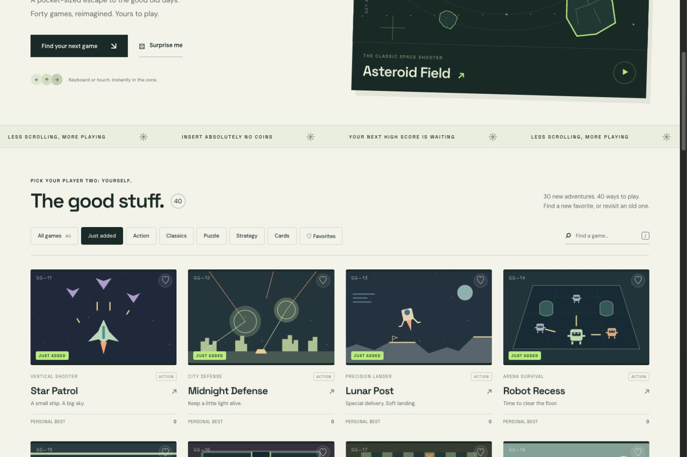

# Geach Games

**Forty little escapes. One browser arcade.**

Geach Games brings classic arcade ideas into a polished, responsive collection with original canvas artwork, smooth animation, and instant play. **Play now: [jordangeach.com/games/](https://jordangeach.com/games/).**



## The collection

| Game | Category | Find your flow |
| --- | --- | --- |
| **Asteroid Field** | Action | Small ship. Infinite universe. |
| **Brick Breaker** | Classics | Find your perfect angle. |
| **Garden Snake** | Classics | A little snack. A longer snake. |
| **Cosmic Invaders** | Action | Earth called. You’re up. |
| **Block Party** | Puzzle | Make a little room. |
| **Paddle Club** | Classics | The original rivalry. |
| **Crossy Creek** | Action | Look both ways. Then go. |
| **Midnight Drive** | Action | Just you and the road. |
| **Sky Hopper** | Action | Catch a little air. |
| **Twenty Forty Eight** | Puzzle | Good things add up. |
| **Star Patrol** | Action | A small ship. A big sky. |
| **Midnight Defense** | Action | Keep a little light alive. |
| **Lunar Post** | Action | Special delivery. Soft landing. |
| **Robot Recess** | Action | Time to clear the floor. |
| **Rocket Courier** | Action | No stairs. Just a little thrust. |
| **Pocket Dungeon** | Action | Four rooms. One good story. |
| **Secret Garden** | Action | Make room for your escape. |
| **Meadow Quest** | Action | A little hop toward home. |
| **Gem Hollow** | Action | Good things lie beneath. |
| **Garden Guardians** | Action | Something’s in the mushrooms. |
| **Mine Garden** | Puzzle | A little logic. A safer step. |
| **Sudoku Studio** | Puzzle | Nine little moments of clarity. |
| **Fifteen, In Order** | Puzzle | Make space. Make sense. |
| **Box Office** | Puzzle | Special delivery. Careful corners. |
| **Little Matches** | Puzzle | A familiar face. A perfect pair. |
| **After Hours** | Puzzle | One last light before you go. |
| **Current Affairs** | Puzzle | Find your flow. |
| **Picture Logic** | Puzzle | A small picture, piece by piece. |
| **Bubble Theory** | Puzzle | A perfect angle. A little pop. |
| **Gem Session** | Puzzle | One good swap starts something. |
| **Four in a Row** | Strategy | A little foresight goes a long way. |
| **Corner Office** | Strategy | Turn the board in your favor. |
| **Crown & Capture** | Strategy | Think a few jumps ahead. |
| **Sunday Solitaire** | Cards | A quiet little shuffle. |
| **Twenty One** | Cards | Know when to stay. |
| **Draw Club** | Cards | Five cards. One good decision. |
| **Lucky Ledger** | Classics | Roll with a plan. |
| **Pocket Pinball** | Classics | Keep the good times rolling. |
| **Little Links** | Classics | Take the scenic route. |
| **Perfect Stack** | Classics | Find the rhythm. |

## Made for a quick game

- Responsive layouts with keyboard, mouse, and touch controls; each game explains its controls before play.
- Search, five genre filters, a Just added view, favorites, and a surprise pick when you cannot choose.
- Personal bests and favorites saved automatically in the current browser.
- Optional synthesized arcade audio, muted by default; pause, restart, retry, and a focused playfield.
- Self-contained static files, including fonts and artwork. No production dependencies, external asset requests, accounts, or backend services.

## Run locally

Use **Node.js 22 or later**. There are no packages to install.

```sh
git clone https://github.com/jordanbgeach/geach-games.git
cd geach-games
npm run dev
```

Open [http://127.0.0.1:4188/games/](http://127.0.0.1:4188/games/). Set `PORT` to use a different local port. Serve the files over HTTP; browser modules do not load correctly from a direct `file://` preview.

| Command | Purpose |
| --- | --- |
| `npm run dev` | Serve the source locally on port 4188. |
| `npm run check` | Check JavaScript syntax and subdirectory-safe entry paths. |
| `npm test` | Run the game and shared-engine regression tests. |
| `npm run build` | Create the production upload folder at `dist/`. |

To preview the build, run `node scripts/serve.mjs --dist` after building. Scores and preferences belong to each browser and origin; they do not sync between devices.

## Deploy to Hostinger

Run the checks and build, then upload the **contents** of `dist/`, including `.htaccess`, to `public_html/games/`. Production assets are stored in versioned release directories so returning players get the new collection without stale JavaScript. The site uses relative assets and needs no Node.js runtime, database, or routing fallback on the host.

See [HOSTINGER.md](HOSTINGER.md) for the complete deployment guide. The GitHub Actions workflow checks, tests, and builds every push and pull request, then provides the built site as a downloadable artifact.

## Project layout

```text
index.html          Arcade library and game shell
src/app.js          Navigation, input, scoring, and game lifecycle
src/games/          Forty independent canvas games
src/engine/         Audio and browser storage
src/collections/    Game metadata, cover art, and collection helpers
src/art.js          Original illustrated game covers
assets/             Local fonts and favicon
scripts/            Dependency-free development and build tools
tests/              Game-rule and engine regression tests
```
